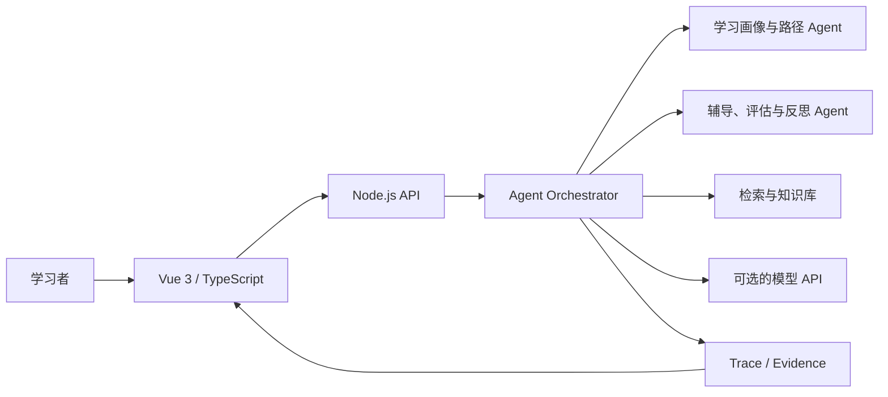

# EduMind · 智学星枢

> 一个把学习画像、路径规划、检索辅助、智能辅导和效果反馈连接起来的个性化学习系统。  
> A personalized learning workspace with traceable agent workflows.

**项目类型**：全栈学习系统原型 · 软件杯 A3 赛题作品  
**主要技术**：Vue 3 · TypeScript · Pinia · Node.js · RAG · 多智能体编排

[功能与演示](#功能与演示) · [技术架构](#技术架构) · [本地运行](#本地运行) · [验证方式](#验证方式) · [设计边界](#设计边界)

---

## 项目概览

传统学习应用通常将学情分析、资源推荐、辅导与测评拆分为独立页面。EduMind 希望建立一个**可追踪的学习反馈闭环**：学习者的信息进入画像与路径模块，系统选择资源并提供辅导，测评后的证据再用于更新学习建议。

| 关注点 | 当前实现 |
| --- | --- |
| 学习闭环 | 画像、资源、路径、辅导、评估、反思的协调流程 |
| Agent 工作流 | 7 个专业 Agent 与编排器，见 `server/agents/` |
| 检索增强 | 本地 96 维 hash embedding，结合标签与关键词检索 |
| 可解释性 | Agent trace、证据查看与执行路径可视化 |
| 模型接入 | 可配置 OpenAI-compatible API；未配置时提供受限 fallback |
| 应用形态 | Vue 前端 + Node.js API；MySQL 为可选组件 |

这个仓库是**可本地演示的应用原型**，不代表已经完成大规模真实学习效果验证，也不承诺公网服务持续可用。

## 功能与演示

**建议从以下页面体验：**

1. **学习主页（`/home`）**：学习状态、推荐路径与阶段性反馈。
2. **学习画像（`/profile`）**：查看学情信息与个性化建议。
3. **路径规划（`/learning-path`）**：围绕学习目标组织推荐步骤。
4. **智能辅导（`/tutoring`、`/dialogue`）**：与辅导模块交互。
5. **效果评估（`/evaluation`、`/reverse-evaluation`）**：查看测评结果、反馈与路径调整信息。

另外包含资源模块、执行流程与管理侧页面。具体路由以 [`src/router/index.ts`](src/router/index.ts) 为准。

<details>
<summary>仓库中的界面素材</summary>

<p align="center">
  
  
</p>

</details>

## 技术架构



- **前端**：Vue Router、Pinia、Three.js / ECharts 等视觉与交互能力；页面代码见 [`src/views/`](src/views)。
- **后端**：Node.js API、学习编排与证据记录，代码见 [`server/`](server)。
- **Agent**：学习画像、资源、路径、知识路径、辅导、评估与反思，见 [`server/agents/`](server/agents)。
- **RAG**：本地哈希表示与混合检索；这**不是**独立向量数据库方案，不能把它描述为生产级语义向量检索。
- **模型调用**：可选外部模型；无密钥或模型调用异常时，部分路径使用确定性/受限 fallback，结果应与真实模型推理区分。

## 本地运行

**前提：** Node.js 20+、npm。MySQL 8、Docker Desktop、兼容 API 的模型密钥是可选或特定部署方式需要的组件。

在仓库根目录执行：

```bash
npm ci
cp .env.example .env
npm run dev
```

PowerShell 可以把第二行改为：

```powershell
Copy-Item .env.example .env
```

`npm run dev` 同时启动 API 与前端开发服务。

| 地址 | 用途 |
| --- | --- |
| `http://localhost:5174/` | 前端开发页面 |
| `http://localhost:8788/api/health` | 后端健康检查 |

<details>
<summary>本地评审演示账号</summary>

仅用于本地 Demo，不对应真实学习者。账号为 `reviewer`，演示密码为 `Zhixue2026!`。请勿将演示认证配置不加修改地用于公网；管理员访问默认关闭，需单独配置。

</details>

**可选模型接入**：通过环境变量 `LLM_API_URL`、`LLM_API_KEY` 与 `LLM_MODEL` 配置。不要把真实密钥提交到 Git；仅提交 `.env.example`。

Docker 部署方案见 [`Dockerfile`](Dockerfile) 与 [`docker-compose.yml`](docker-compose.yml)，它与上面的免外部依赖开发模式不同，需先配置数据库与模型相关环境变量。

## 验证方式

下面是仓库 [`package.json`](package.json) 提供的验证入口；**本 README 更新不等于重新执行或认证这些测试结果**。

```bash
npm test
npm run build
npm run experiment:rag-contest
npm run experiment:anomaly
```

学习闭环实验依赖已启动的 API：在一个终端保持 `npm run dev`，另一终端执行：

```bash
npm run experiment:learning-cycle
```

代码与研究脚本分别在 [`server/`](server)、[`experiments/`](experiments)；前端测试位于 `src/` 与服务端测试文件中。

## 设计边界

- **应用研究原型**，不是已证明可以提升真实教育结果的正式教学系统。
- **检索实现有边界**：96 维 hash embedding 与标签、关键词混合，不能当作通用预训练语义 embedding。
- **模型能力有边界**：真实模型调用和本地 fallback 必须区分；离线演示可用并不表示在线模型已通过验收。
- **数据与权限**：公开仓库仅提供演示代码与相应数据路径，部署真实服务前仍需审核权限、密钥、隐私与日志保留策略。
- **第三方资源**：使用须遵守 [`THIRD_PARTY_NOTICES.md`](THIRD_PARTY_NOTICES.md)，不能默认所有素材可再分发。

## 从哪里读源码

| 想了解什么 | 推荐入口 |
| --- | --- |
| 前端路由与页面 | [`src/router/index.ts`](src/router/index.ts) · [`src/views/`](src/views) |
| Agent 结构与编排 | [`server/agents/`](server/agents) |
| API 服务与数据流 | [`server/index.js`](server/index.js) |
| 知识检索 | [`server/knowledge-base/`](server/knowledge-base) |
| 评测脚本 | [`experiments/`](experiments) |
| 环境与部署 | [`.env.example`](.env.example) · [`docker-compose.yml`](docker-compose.yml) |

---

<sub>EduMind is an educational engineering prototype. Its repository documents implemented workflows and verifiable entry points rather than promising educational efficacy.</sub>
