# 天池论坛参赛帖子 · 已发布

> 已于 2026-11-08 发布：https://tianchi.aliyun.com/forum/post/1095688
> 标签：实验代码、天池大赛；关联比赛：2026 Qoder 高校创造力大赛。
> 本文件为存档源稿；线上版图片链接已替换为天池 CDN（userimg/1095280995893/2026-11-08/）。
> 2026-11-08 增补「可视化与核心创新」一节（中枢 / 星图 / 星座 / 知识树 / 反向更新），按线上实际版本截图。
> 待办：确认刘宏伟完成天池实名认证 + 阿里云大学生认证；如有社交分享链接可编辑帖子补充。

## 标题

〖StudyHack〗智学星枢：一个能够持续理解学生、规划学习路径的 AI 导师

## 正文

### 自我介绍

我们是来自**安徽中医药大学**的两人参赛团队：**朱玉阳**（数据科学与大数据技术专业）、**刘宏伟**（人工智能专业）。团队共同开发了智学星枢（EduMind）多智能体个性化学习平台，GitHub @Zhuyuyangyy；本次参赛用 Qoder 把它改造成了人人可公开体验的学习闭环版本。

**Qoder 账号**：17368893899

**作品链接：https://astripath-k78u5s6qgf1.qoder.zone**（Qoder Sites 部署，公开访问，无需登录，评委点开即用）

**团队分工：**
- 朱玉阳：项目负责人。赛题解读与产品方向决策（沿用原版界面与可视化）、原版智学星枢平台开发、竞赛版最终审核与天池提交；
- 刘宏伟：AI 算法与数据。参与掌握度更新规则、学习计划算法与导师检索方案的设计评审，负责演示课程数据整理与测试验收；
- 工程实现、演示数据编写、自动化测试、Qoder Sites 部署与文档由 Qoder Agent 完成（过程见第五节）。

---

### 一、我的作品是什么

**智学星枢（AstriPath）是一个面向高校学生的 AI 个性化学习系统：学生在自学课程时，它通过诊断建立知识画像、生成个性化学习路径，并用 AI 导师与针对性练习持续跟踪掌握度、动态调整后续学习任务。**

它不只是回答问题，而是根据学习表现决定「下一步该学什么」，形成 诊断 → 画像 → 计划 → 导师 → 练习 → 反馈 的完整闭环。

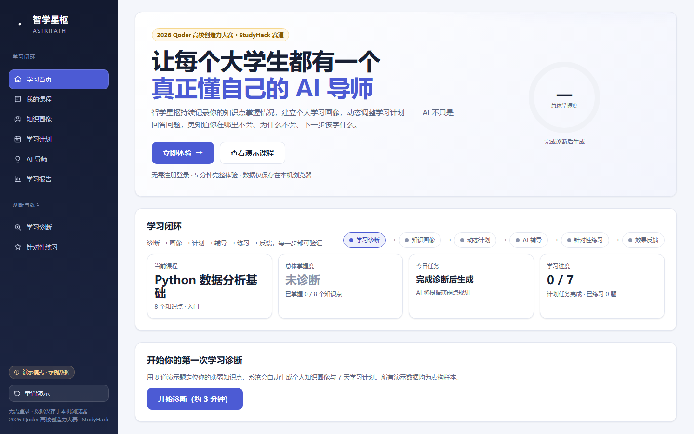

首页保留完整原版界面：3D 知识宇宙、知识星座、多智能体可视化；竞赛学习闭环从首页横幅一键进入：

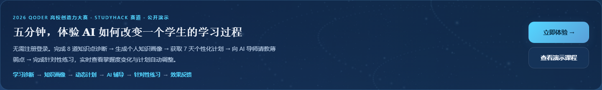

### 二、看得见的学习闭环：可视化与核心创新

我们没有把 AI 做成一个黑盒对话框，而是把「系统如何理解你」的每一步都做成了可操作、可解释的 3D 可视化。以下为当前线上版本实拍。

**核心创新 01 · 多智能体协同：6 大模块、7 个核心智能体，中枢统一编排**

一次学习卡顿会被拆给 6 个模块接力处理：画像诊断 → 路径编排 → 资源生产 → 辅导互动 → 测评分析 → 反馈复盘。左侧实时显示「当前接力」与每个模块的输入输出，右侧 3D 编排中枢按学习任务节拍亮起，下方同步展示本棒产出（引用课程、知识点掌握度、下一步交给谁）——每一步决策都看得见，而不是等一个笼统的回答。

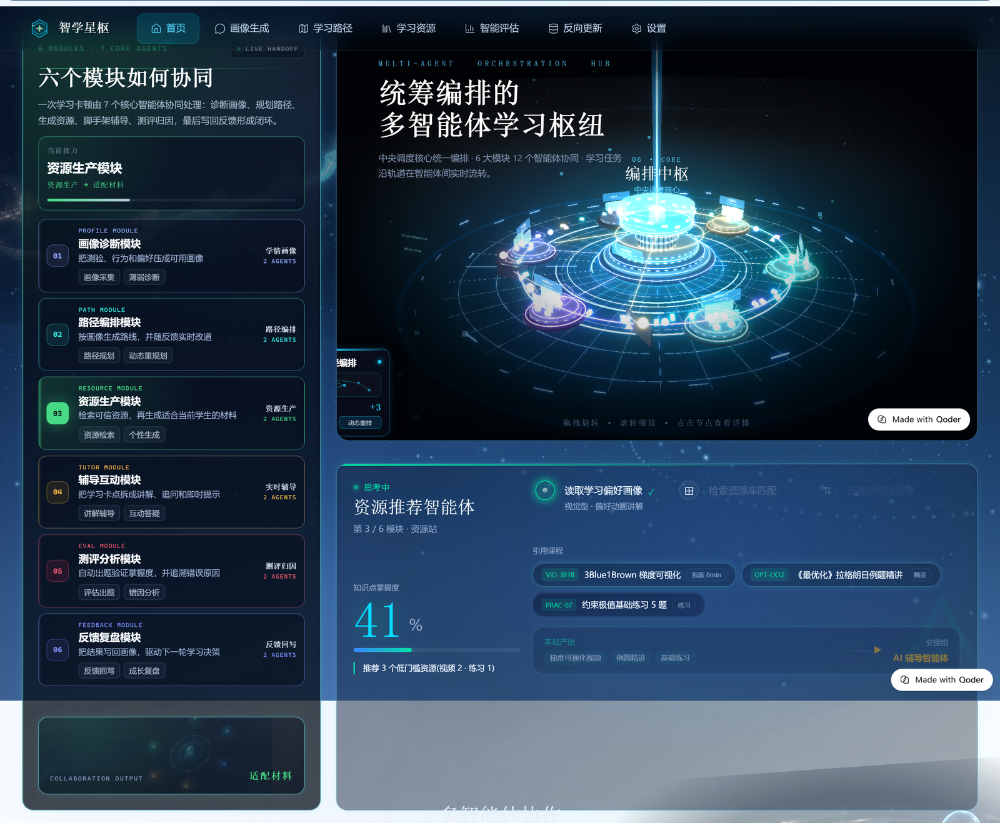

**核心创新 02 · 反向更新：从「一次推荐」到「动态进化」**

答题、对话、资源学习都会沉淀为证据，反向更新知识画像、知识图谱与学习路径。页面完整展示 4 步过程、证据计数与更新前后对比；规则是确定性的（证据不足不写回画像），页面上会直说「本轮未检测到学完证据，因此不生成新画像版本」，不虚报结果。

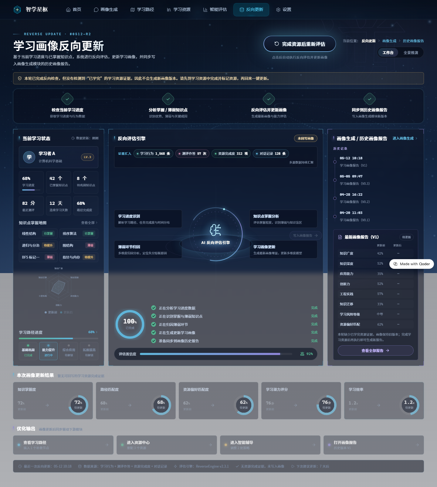

**核心创新 03 · 可信回答：每条结论都有引用依据**

AI 导师基于课程知识库检索回答，附讲解、示例、常见错误与**引用依据**；界面明确标注「演示模式」，超出知识库范围会明确告知，不编造答案。

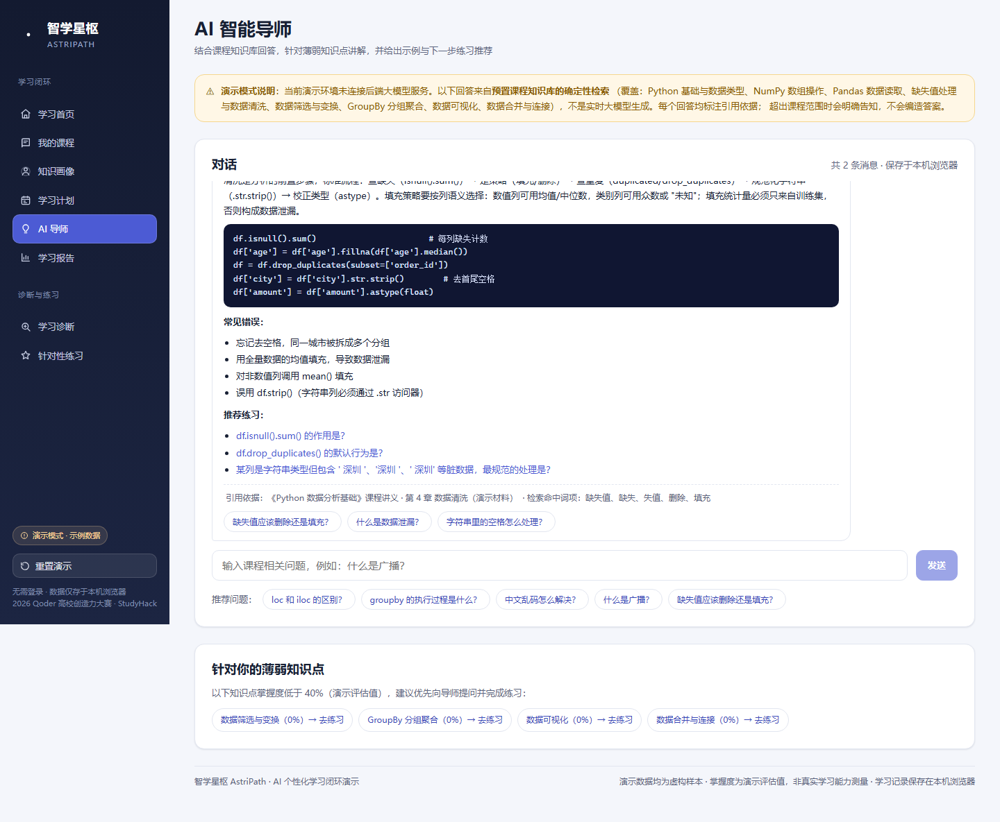

**可视化亮点：星图、星座与知识树**

- **个性化学习路径星图**（首页）：把薄弱知识点、先修关系与学习目标编成星系轨道，学生一眼看到「我在哪、下一步去哪」；
- **知识星座**（学习路径页）：每颗星是一个知识点，亮度即掌握度，同域知识点连成星座，跨域知识桥用细光路连接，点击星点联动阶段任务；
- **3D 知识树与智能评估**：知识点长在树上，果实状态对应掌握/待掌握/需巩固，右侧给出综合掌握度、已评估知识点数与变化趋势（界面标注演示数据）。

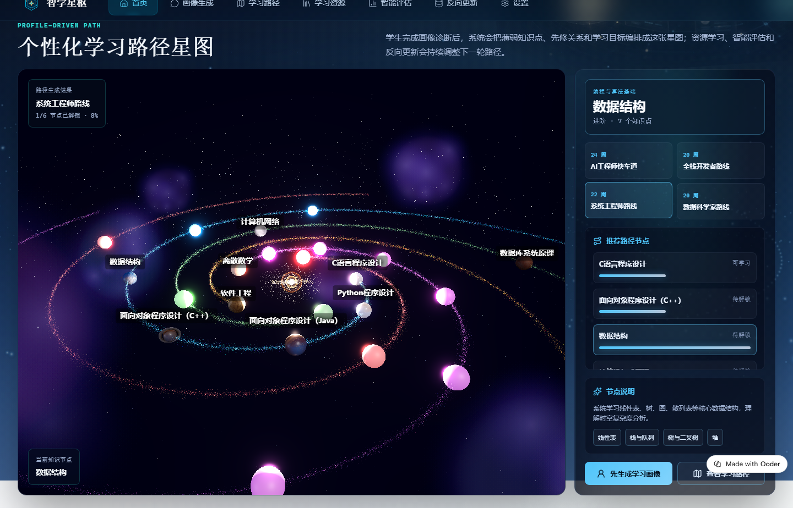

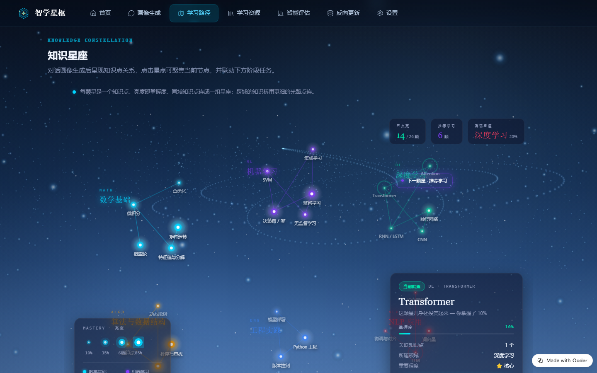

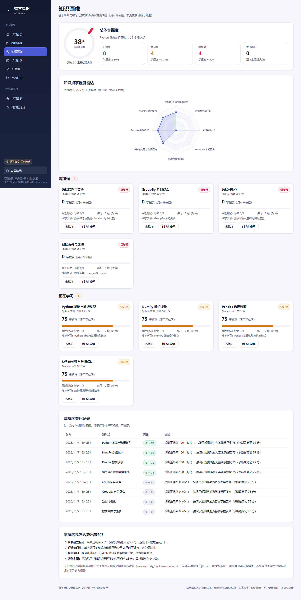

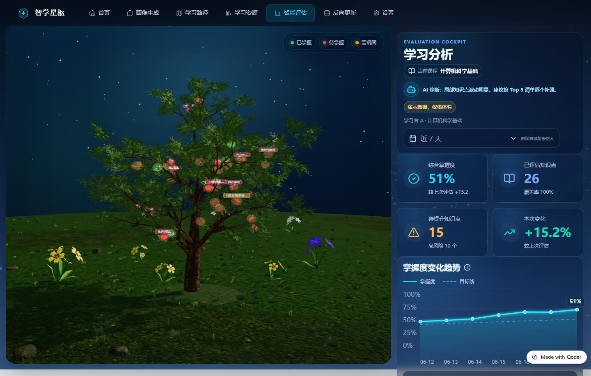

### 三、为什么做

想法来自我自己用 AI 工具学习时的真实痛点：**AI 能答对每一道题，却不知道我哪里不会**。问完就忘，下次还是从零开始；学习计划一旦生成就固定不变，练得好坏都不会调整。

我希望做一个「能持续理解学生」的导师：先诊断出知识点级的薄弱处，再让每一次练习都留下证据、改变画像、重排计划。本项目基于团队已有的智学星枢工程（多智能体学习平台）改造，把「持续理解」这件事做成可公网体验的完整闭环。

### 四、怎么用（5 步，约 5 分钟）

1. 打开作品链接，首页点击竞赛横幅「立即体验」。
2. 完成 8 道知识诊断（Python 数据分析演示课程），查看逐知识点正确率与解析。
3. 查看知识画像：3D 知识树、薄弱知识点分组、掌握度变化记录。
4. 让 AI 导师讲解薄弱点（每个回答带课程资料引用依据），再完成针对性练习。
5. 查看掌握度变化与自动重排的 7 天计划，最后到学习报告看前后对比。

### 五、用 Qoder 做出来的过程

**开发与部署全部由 Qoder 完成**，我们负责方向决策与最终审核。关键过程如下：

**第 1 步 · 工程审计（交给 Qoder）**：让 Qoder 对已有工程做全面审计——仓库结构、前后端、认证、RAG、测试基线，并实跑原工程测试取证（18/18 通过），产出审计报告。

**第 2 步 · 竞赛版开发（交给 Qoder）**：Qoder 创建隔离竞赛分支，编写演示课程/题库/知识库，实现判分、掌握度更新、计划生成、导师检索全部核心逻辑与页面，完成 Qoder Sites 部署。

**第 3 步 · 我们改了什么（人工决策）**：第一版是独立重建的界面，看后觉得「按照原来那个整体的界面就不错，改完就很普通了」，要求 Qoder **沿用原版界面和全部可视化**（3D 知识宇宙、知识树、知识星座）；顶部栏目也要求恢复原版 7 个，不做过度设计。Qoder 据此把竞赛版重建为「原版应用 + 演示模式」：免登录会话、本地 API 模拟层、5 个闭环视图嵌入原工程。

**第 4 步 · 测试与修复（交给 Qoder）**：44 个逻辑单元测试 + 10 个 Playwright 端到端测试 + 原工程 278 项回归。测试真实暴露并修复了 8 个问题，例如：计划算法中薄弱知识点被无关先修挤占（重写为薄弱优先 + 先修闭包）、导师检索子串误匹配（重构评分）、练习未改变掌握度时证据不留痕（修复为证据必留痕）、Live2D 桌宠遮挡移动端按钮（演示模式预置关闭）。

**第 5 步 · 部署与线上验收（交给 Qoder）**：静态资源从 371MB 裁剪压缩到 30MB（模型 meshopt 压缩 21.8MB→2MB），Qoder Sites 公开发布，线上 12 项验收全部通过（免登录、闭环全流程、深链接、移动端无横向溢出）。

以下为竞赛闭环实拍截图凭证（桌面 1440px + 移动端）：

**① 知识诊断**：8 题逐知识点判分，提交后输出正确率表与解析。

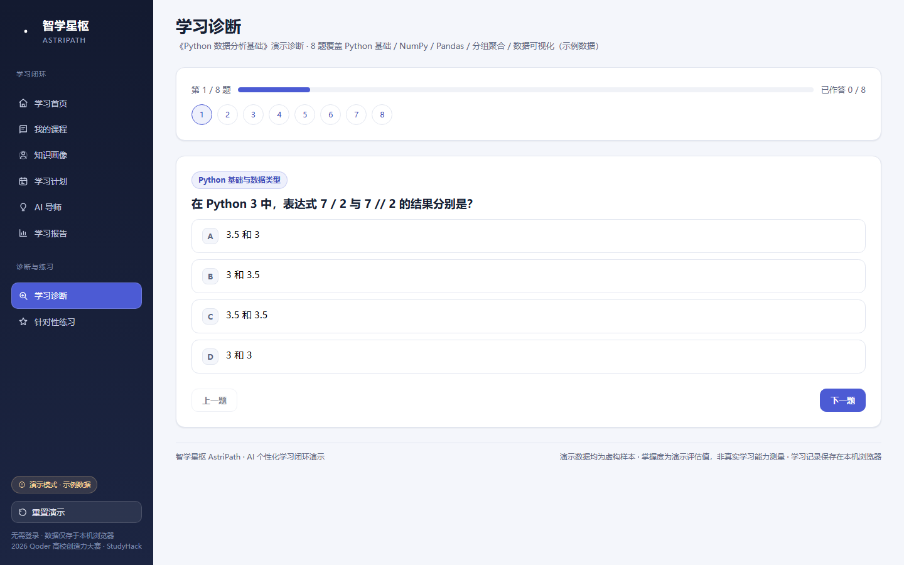

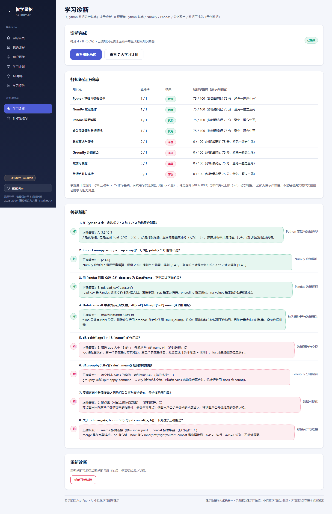

**② 知识画像**：3D 知识树按先修关系组织，节点状态反映掌握度；薄弱分组、变化流水、规则说明全程可解释（实拍见第二节知识树）。

**③ 学习计划**：7 天计划薄弱优先、尊重先修关系，每个任务附推荐理由；掌握度变化后自动重排。

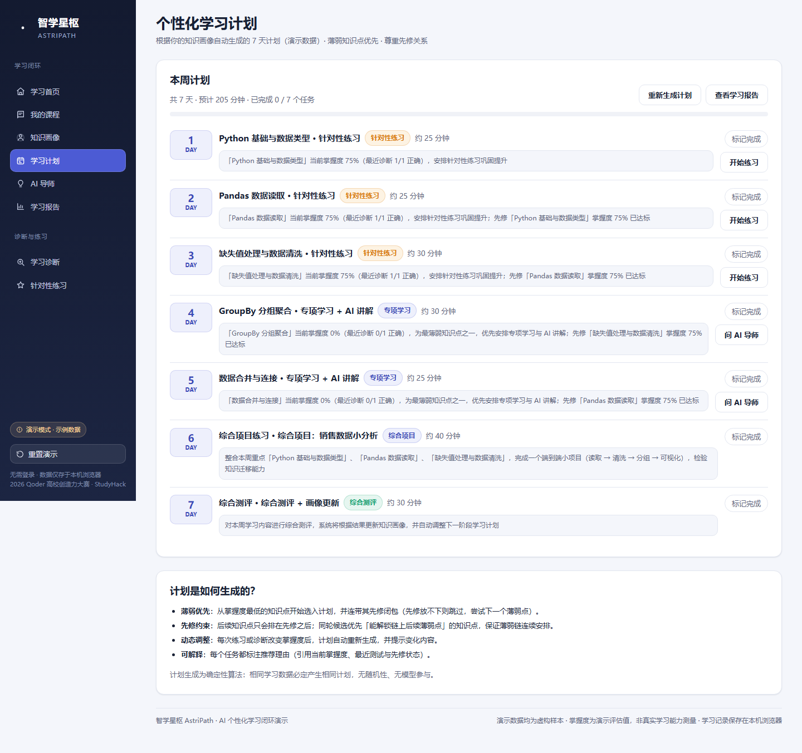

**④ AI 导师与针对性练习**：导师回答带引用依据（见第二节创新 03）；练习题目绑定知识点、即时判分，下图实拍一次练习后掌握度 75→83（+8），并给出可解释原因。

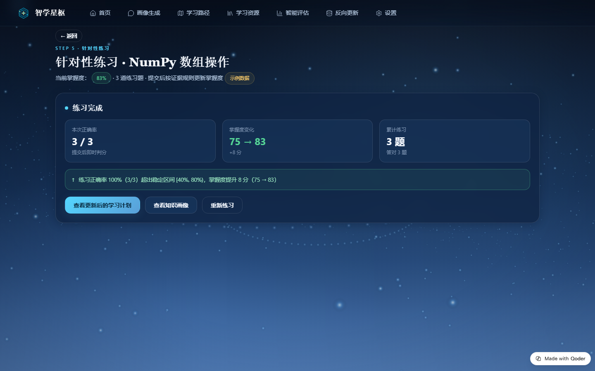

**⑤ 学习报告**：学习前后对比、变化流水、下一步推荐。

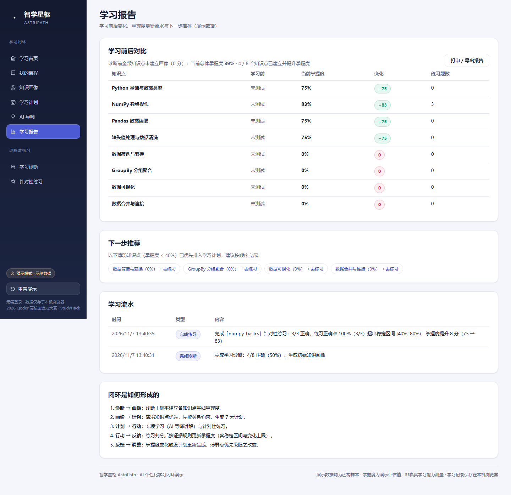

**⑥ 原版可视化保留**：学习路径页的知识星座（实拍见第二节），首页 3D 知识宇宙与编排中枢均原样保留。

**⑦ 移动端适配**（375px 无横向溢出，可完整答题）：

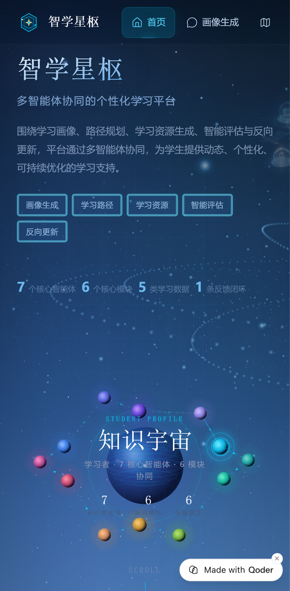

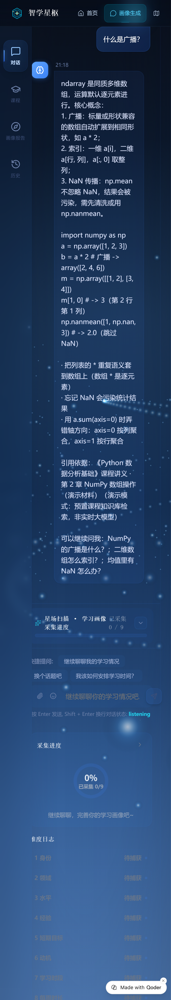

### 六、技术实现与测试

- **技术栈**：Vue 3 + TypeScript + Vite + Pinia + Three.js/ECharts，静态应用无后端依赖，localStorage 持久化，桌面/移动响应式。
- **核心算法确定性可复现**：判分、掌握度更新（证据量门槛 / 稳定区间 / 单次变化上限 ±8）、7 天计划（薄弱优先 + 先修闭包 + 链连续性），相同输入必得相同输出；规则移植自正式工程的证据驱动实现。
- **测试**：44 逻辑单测 + 10 E2E + 原工程 278 项回归全部通过；线上部署 12 项验收全部通过。
- **部署**：Qoder Sites 静态托管，公开访问，无登录、无密钥、无数据库写入。

### 诚实声明

- 演示课程、题目、讲解、评估统计均为虚构样本，界面已标注「示例数据」。
- AI 导师为**演示模式**：回答来自预置知识库的确定性检索，非实时大模型；每个回答标注引用依据，超出范围明确告知，不编造答案。
- 掌握度为**演示评估值**，非真实用户实验验证的能力测量；学习记录仅保存在评委本机浏览器。

---

**让每个大学生都有一个真正懂自己的 AI 导师。**
