# 天池帖子 V3 草稿 · 终版（待登录后与 #23 合并为一次编辑发布）

> 状态：本地草稿，未发布。发布动作与「灰罩截图替换」合并为一次编辑器提交，避免二次审核。
> 图位 15 个 / 图片文件 16 张（移动端左右并排算 1 图位）。
> V3 相对 V2 的整改：① 测试数字统一为 44 单测 / 12 E2E（10 桌面+2 移动）/ 原工程全量回归 281 项（222 过/59 跳/0 失败）/ 线上 12 验收；② 智能评估改去水印驾驶舱裁切并重写图注（与裁切像素一致、注明演示上下文）；③ 移动端右屏改用真实「回答依据与推荐追问」裁切并补导航层级说明；④ commit 证据改 mastery.ts 彩色 diff 实拍；⑤ 智能体口径加 footnote。
> 账号手机号保留：官方合格条件明文要求填写 Qoder 账号，脱敏会导致资格不符（见 SUBMISSION_CHECKLIST）。
> 沿用原版全部可视化（用户决策），截图均与线上产品一致；知识树/评估用真实像素取景裁切，不重绘。

## 上传清单（12 张，编辑器工具栏上传后替换正文对应本地路径）

| # | 本地文件 | 处置 |
|---|---|---|
| 1 | screenshots/home-agent-hub.png | 替换旧 CDN fDYnN5aOT7vF8AVL（灰罩重拍） |
| 2 | screenshots/reverse-update.png | 替换旧 CDN vxYx9RAfhoLaoIlq（灰罩重拍） |
| 3 | screenshots/diagnosis-result.png | 替换旧 CDN cutHabwUYsnR7rYM（灰罩重拍） |
| 4 | screenshots/learning_plan.png | 替换旧 CDN NpAJuusXcJ9O3zSH（灰罩重拍） |
| 5 | screenshots/learning_report.png | 替换旧 CDN EJaWYl4QnyLIsY23（灰罩重拍） |
| 6 | screenshots/crops/kmap-tree-framed.png | 替换旧 CDN Zhr670kz99azwmIU（全页→卡片裁切） |
| 7 | screenshots/crops/eval-cockpit.png | 替换旧 CDN iVHDCF1y8u6Ljhn8（去水印驾驶舱裁切，V3 重拍） |
| 8 | screenshots/crops/mobile-tutor-a.png | 替换旧 CDN Y15gdjv3tKhVW06N（长图→左屏） |
| 9 | screenshots/crops/mobile-tutor-citation.png | 新增（右屏·回答依据与推荐追问） |
| 10 | evidence/qoder-dev/01-engineering-audit.png | 新增（Qoder 证据①） |
| 11 | evidence/qoder-dev/02-core-logic-fix-commit.png | 新增（Qoder 证据②·mastery.ts 彩色 diff，V3 重拍） |
| 12 | evidence/qoder-dev/03-sites-deploy-record.png | 新增（Qoder 证据③） |

保留不变 CDN（4）：home=VN9aCpnZrMjBQ2dr、home-galaxy=2026-11-17/2WcFe4PuTXXgnSXr、learning-path=w1WrbIYeTpY9LhMo、practice-result=VQT3UFvgRiDSdYU9（base https://static.tianchi.aliyun.com/userimg/1095280995893/2026-11-08/）。
删除不再出现（4）：banner=tdpNMtDV6UWRQHgM、diagnosis=Y84hajOhfh7HeQts、ai_tutor=zhh9Wx64NsQIXno5、mobile-nav=8hFLk5zRmhMJ907I。
并排实现：优先 GFM 表格两单元格各放一图；若天池渲染器不支持表内图片，回退上下排列并加「左屏/右屏」 caption。

---

### 自我介绍

我们是来自**安徽中医药大学**的两人参赛团队：**朱玉阳**（数据科学与大数据技术专业）、**刘宏伟**（人工智能专业）。团队共同开发了智学星枢（EduMind）多智能体个性化学习平台，GitHub @Zhuyuyangyy；本次参赛用 Qoder 把它改造成了人人可公开体验的学习闭环版本。

**Qoder 账号**：17368893899

**作品链接：https://astripath-k78u5s6qgf1.qoder.zone**（Qoder Sites 部署，公开访问，无需登录，评委点开即用）

**团队分工：**
- 朱玉阳：项目负责人。赛题解读与产品方向决策（沿用原版界面与可视化）、原版智学星枢平台开发、竞赛版最终审核与天池提交；
- 刘宏伟：AI 算法与数据。参与掌握度更新规则、学习计划算法与导师检索方案的设计评审，负责演示课程数据整理与测试验收；
- 本次竞赛版的工程改造、演示数据编写、核心逻辑实现、自动化测试及 Qoder Sites 部署由 Qoder Agent 执行（过程见第五节）。

---

### 一、我的作品是什么

**智学星枢（AstriPath）是一个面向高校学生的 AI 个性化学习系统：学生在自学课程时，它通过诊断建立知识画像、生成个性化学习路径，并用 AI 导师与针对性练习持续跟踪掌握度、动态调整后续学习任务。**

它不只是回答问题，而是根据学习表现决定「下一步该学什么」，形成 诊断 &rarr; 画像 &rarr; 计划 &rarr; 导师 &rarr; 练习 &rarr; 反馈 的完整闭环。

首页保留完整原版界面：3D 知识宇宙、知识星座、多智能体可视化；竞赛学习闭环从首页横幅一键进入。下图为知识宇宙星图近景（2026-11-17 修复 15 个缺失星球模型后的线上实拍）：

### 二、核心创新与可视化（当前线上版本实拍）

我们没有把 AI 做成一个黑盒对话框，而是把「系统如何理解你」的每一步都做成了可操作、可解释的可视化。

**核心创新 01 · 多智能体协同：6 大模块、7 个核心智能体，中枢统一编排**

一次学习卡顿会被拆给 6 个模块接力处理：画像诊断 &rarr; 路径编排 &rarr; 资源生产 &rarr; 辅导互动 &rarr; 测评分析 &rarr; 反馈复盘。左侧实时显示「当前接力」与每个模块的输入输出，右侧 3D 编排中枢按学习任务节拍亮起，下方同步展示本棒产出（引用课程、知识点掌握度、下一步交给谁）&mdash;&mdash;每一步决策都看得见，而不是等一个笼统的回答。

> 口径说明：后端为 7 个领域智能体 + 1 个编排器；「编排枢纽」主链按 6 大模块展示；AgentHub 界面以「模块 &times; 子智能体」呈现 12 张卡片。三者是同一架构的不同视图层级，非矛盾计数。

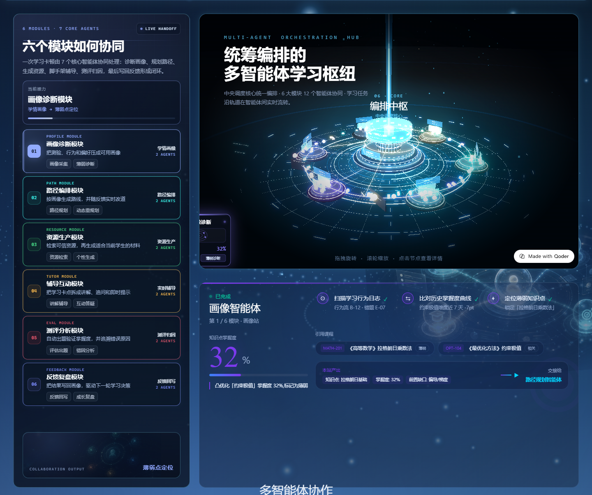

**核心创新 02 · 反向更新：从「一次推荐」到「动态进化」**

答题、对话、资源学习都会沉淀为证据，反向更新知识画像、知识图谱与学习路径。页面完整展示 4 步过程、证据计数与更新前后对比；规则是确定性的（证据不足不写回画像），页面上会直说「本轮未检测到学完证据，因此不生成新画像版本」，不虚报结果。

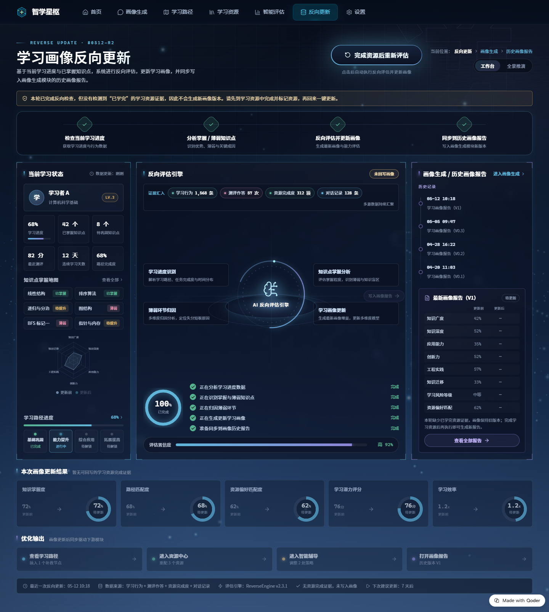

**核心创新 03 · 个性化路径可视化：知识星座与先修星图**

学习路径页把每个知识点做成一颗星：亮度即掌握度，同域知识点连成星座，跨域知识桥用细光路连接，点击星点联动阶段任务；首页星图则把薄弱点、先修关系与学习目标编成星系轨道，学生一眼看到「我在哪、下一步去哪」。3D 知识树另以先修边（绿实线=先修已达标、灰虚线=未达标）组织知识点，见下方可视化实拍。

**可视化实拍 ① · 3D 知识树（知识图谱卡片取景）**

节点大小与颜色反映掌握度，拖动旋转、点击节点查看详情；连线表示先修关系（箭头由先修指向后续）。图例与节点状态同框，评估规则全程可解释。

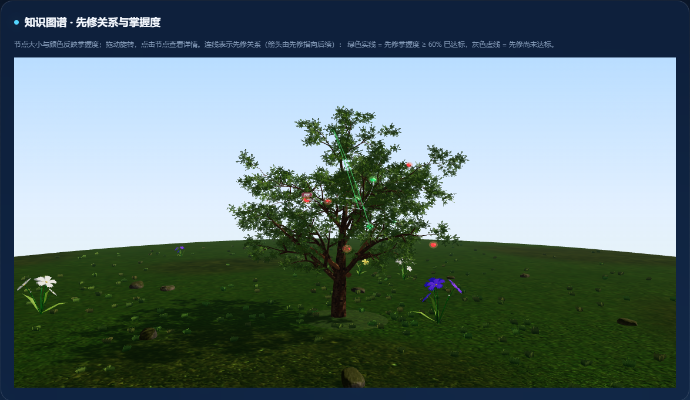

**可视化实拍 ② · 智能评估驾驶舱（关键指标，去水印裁切）**

下图为评估驾驶舱顶部指标区实拍：综合掌握度 **51%（较上次 +19.7）**、已评估知识点 **26（覆盖率 100%）**、待提升 **15 个（高风险 10 个）**、本次变化 **+19.7%**，并带「演示数据，仅供体验」标注。说明：评估驾驶舱沿用原平台「计算机科学基础」演示上下文（与第四节 Python 闭环演示为两套独立演示数据），数值为演示评估值、每次加载按演示规则生成，非真实学习能力测量。

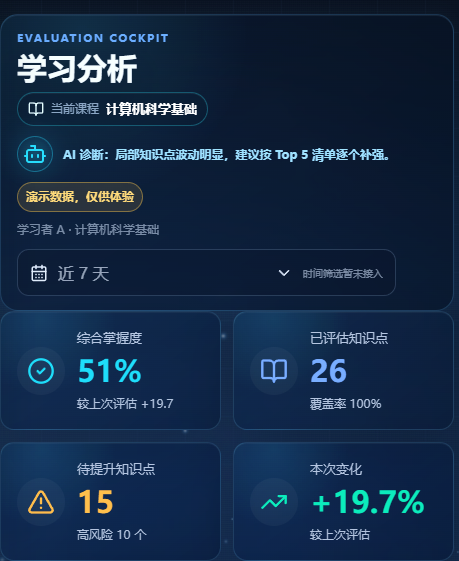

**可信回答**：AI 导师基于课程知识库检索回答，附讲解、示例、常见错误与**引用依据**，界面明确标注「演示模式」，超出知识库范围会明确告知，不编造答案&mdash;&mdash;移动端实拍见第四节右屏。

### 三、为什么做

想法来自我自己用 AI 工具学习时的真实痛点：**AI 能答对每一道题，却不知道我哪里不会**。问完就忘，下次还是从零开始；学习计划一旦生成就固定不变，练得好坏都不会调整。

我希望做一个「能持续理解学生」的导师：先诊断出知识点级的薄弱处，再让每一次练习都留下证据、改变画像、重排计划。本项目基于团队已有的智学星枢工程（多智能体学习平台）改造，把「持续理解」这件事做成可公网体验的完整闭环。

### 四、怎么用（5 步，约 5 分钟）

1. 打开作品链接，首页点击竞赛横幅「立即体验」。
2. 完成 8 道知识诊断（Python 数据分析演示课程），查看逐知识点正确率与解析。
3. 查看知识画像：3D 知识树、薄弱知识点分组、掌握度变化记录。
4. 让 AI 导师讲解薄弱点（每个回答带课程资料引用依据），再完成针对性练习。
5. 查看掌握度变化与自动重排的 7 天计划，最后到学习报告看前后对比。

**闭环四步实拍：**

**① 诊断结果**：8 题逐知识点判分，提交后输出正确率表与解析。

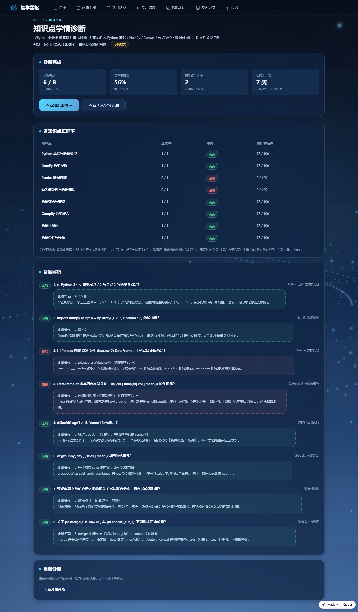

**② 学习计划**：7 天计划薄弱优先、尊重先修关系，每个任务附推荐理由；掌握度变化后自动重排。

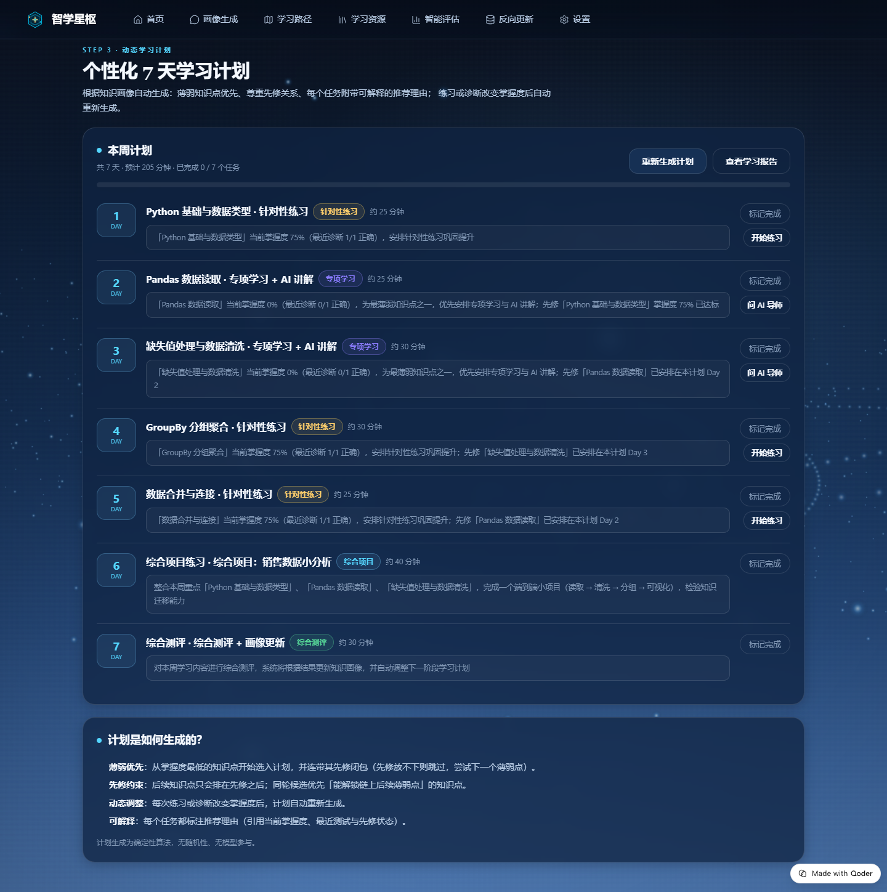

**③ 练习反馈**：练习题目绑定知识点、即时判分，下图实拍一次练习后掌握度 75&rarr;83（+8），并给出可解释原因。

**④ 学习报告**：学习前后对比、变化流水、下一步推荐。

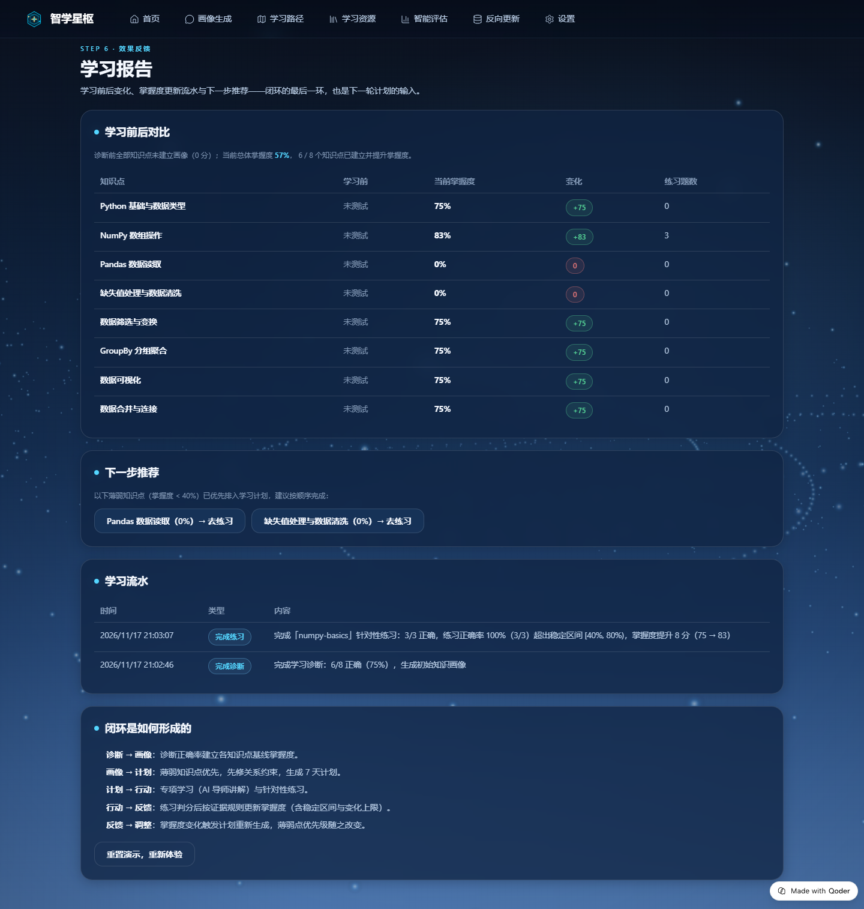

**移动端 AI 导师实拍**（375px 无横向溢出、可完整答题；左右均为**完整手机屏**，含顶部导航与底部输入栏，非局部裁切）。导航说明：顶部「画像生成」为当前模块、左侧「对话」为该模块下的子页签，二者同时高亮属正常层级关系，非状态错误。左屏=提问与讲解，右屏=回答依据与推荐追问：

| 左屏 · 提问与讲解 | 右屏 · 回答依据与推荐追问 |
|---|---|
| 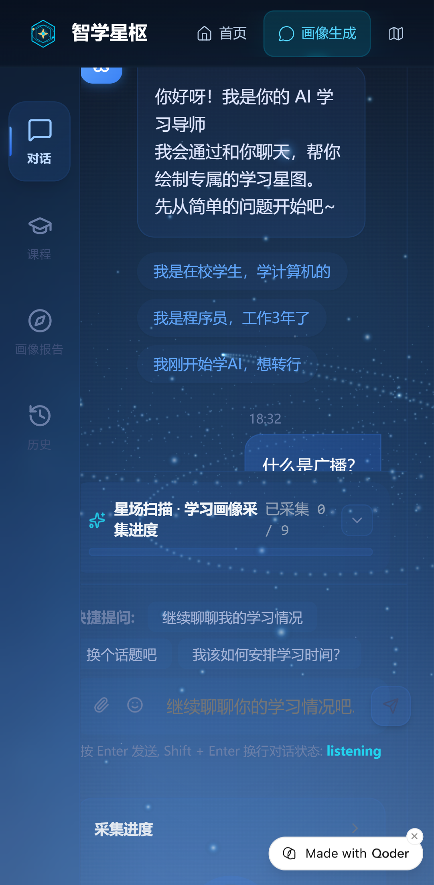 | 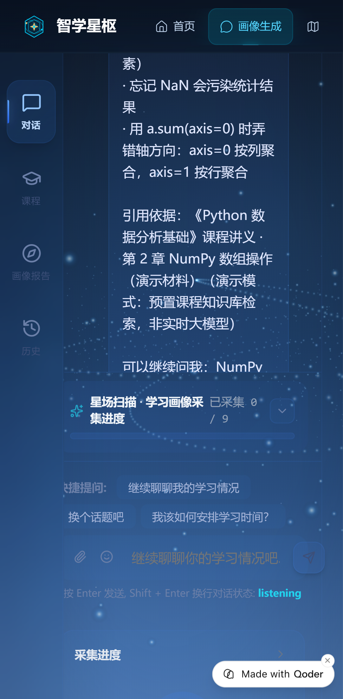 |

右屏可见引用依据《Python 数据分析基础》课程讲义·第 2 章 NumPy 数组操作（演示材料），并明示「演示模式：预置课程知识库检索，非实时大模型」，下方给出推荐追问。

### 五、用 Qoder 做出来的过程

**开发与部署全部由 Qoder 完成**，我们负责方向决策与最终审核。关键过程与真实记录凭证如下（凭证均为 GitHub 公开仓库页面实拍，链接可复核）：

**第 1 步 · 工程审计（交给 Qoder）**：让 Qoder 对已有工程做全面审计&mdash;&mdash;仓库结构、前后端、认证、RAG、测试基线，并实跑原工程测试取证（18/18 通过），产出审计报告。

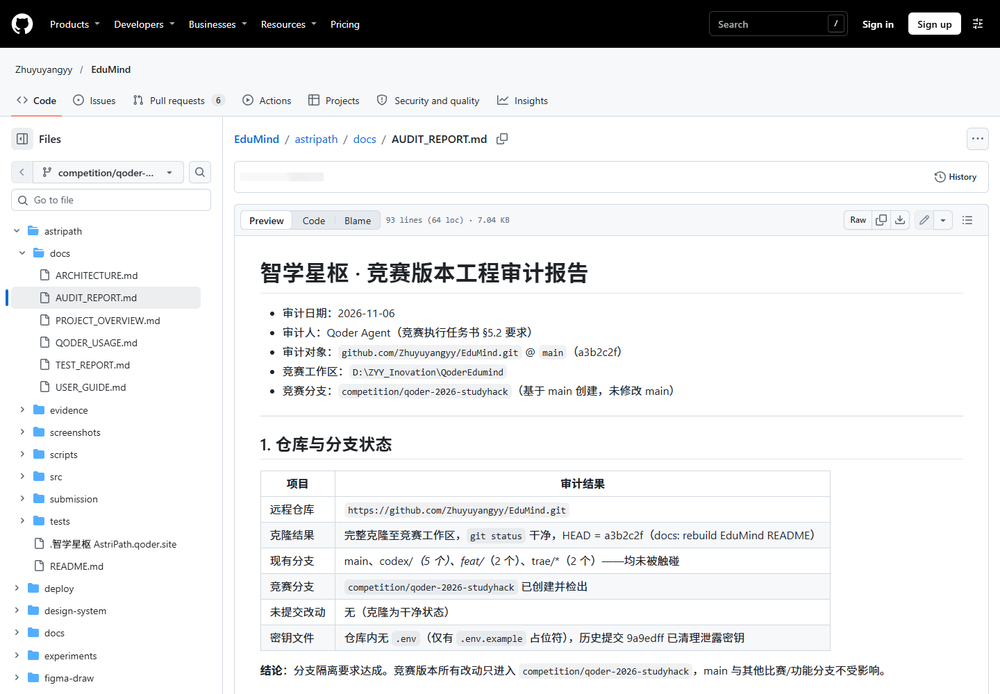

凭证源：https://github.com/Zhuyuyangyy/EduMind/blob/competition/qoder-2026-studyhack/astripath/docs/AUDIT_REPORT.md

**第 2 步 · 竞赛版开发（交给 Qoder）**：Qoder 创建隔离竞赛分支，编写演示课程/题库/知识库，实现判分、掌握度更新、计划生成、导师检索全部核心逻辑与页面，完成 Qoder Sites 部署。

**第 3 步 · 我们改了什么（人工决策）**：第一版是独立重建的界面，看后觉得「按照原来那个整体的界面就不错，改完就很普通了」，要求 Qoder **沿用原版界面和全部可视化**（3D 知识宇宙、知识树、知识星座）；顶部栏目也要求恢复原版 7 个，不做过度设计。Qoder 据此把竞赛版重建为「原版应用 + 演示模式」：免登录会话、本地 API 模拟层、5 个闭环视图嵌入原工程。

**第 4 步 · 测试与修复（交给 Qoder）**：44 个逻辑单元测试 + 12 个 Playwright 端到端测试（10 桌面 + 2 移动）+ 原工程全量回归 281 项（222 过 / 59 跳 / 0 失败，59 跳为需 MySQL 的生产环境用例）。测试真实暴露并修复了 8 个问题，例如：计划算法中薄弱知识点被无关先修挤占（重写为薄弱优先 + 先修闭包）、导师检索子串误匹配（重构评分）、练习未改变掌握度时证据不留痕（修复为证据必留痕）、Live2D 桌宠遮挡移动端按钮（演示模式预置关闭）。下图为「证据必留痕」修复的真实提交记录（commit ed1afce，mastery.ts 核心逻辑彩色 diff 与新增回归测试）：

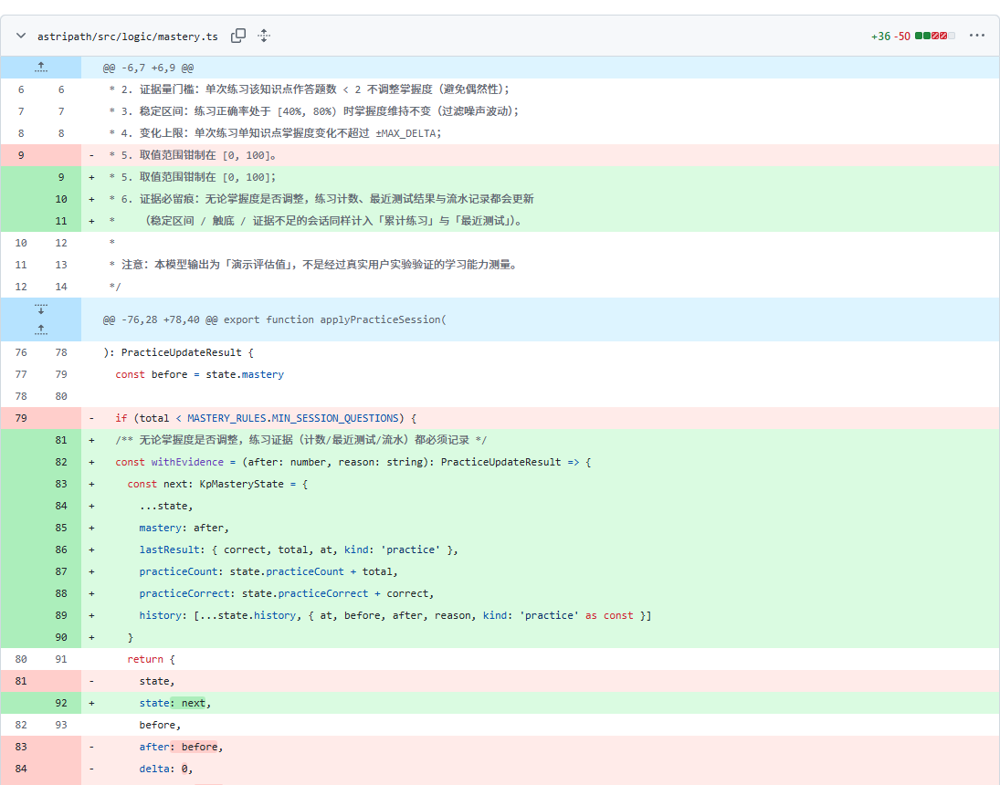

凭证源：https://github.com/Zhuyuyangyy/EduMind/commit/ed1afce

**第 5 步 · 部署与线上验收（交给 Qoder）**：静态资源从 371MB 裁剪压缩到 30MB（模型 meshopt 压缩 21.8MB&rarr;2MB），Qoder Sites 公开发布，线上 12 项验收全部通过（免登录、闭环全流程、深链接、移动端无横向溢出）。下图为部署记录原文（prepare/publish 操作 ID、公开访问模式、验收结论）：

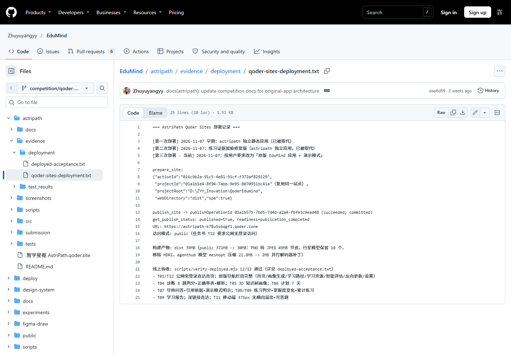

凭证源：https://github.com/Zhuyuyangyy/EduMind/blob/competition/qoder-2026-studyhack/astripath/evidence/deployment/qoder-sites-deployment.txt

### 六、技术实现与测试

- **技术栈**：Vue 3 + TypeScript + Vite + Pinia + Three.js/ECharts，静态应用无后端依赖，localStorage 持久化，桌面/移动响应式。
- **核心算法确定性可复现**：判分、掌握度更新（证据量门槛 / 稳定区间 / 单次变化上限 &plusmn;8）、7 天计划（薄弱优先 + 先修闭包 + 链连续性），相同输入必得相同输出；规则移植自正式工程的证据驱动实现。
- **测试**：44 逻辑单测 + 12 E2E（10 桌面 + 2 移动）+ 原工程全量回归 281 项（222 过 / 59 跳 / 0 失败）；线上部署 12 项验收全部通过。
- **部署**：Qoder Sites 静态托管，公开访问，无登录、无密钥、无数据库写入。

### 诚实声明

- 演示课程、题目、讲解、评估统计均为虚构样本，界面已标注「示例数据 / 演示数据，仅供体验」。
- AI 导师为**演示模式**：回答来自预置知识库的确定性检索，非实时大模型；每个回答标注引用依据，超出范围明确告知，不编造答案。
- 掌握度为**演示评估值**，非真实用户实验验证的能力测量；学习记录仅保存在评委本机浏览器。

---

**让每个大学生都有一个真正懂自己的 AI 导师。**